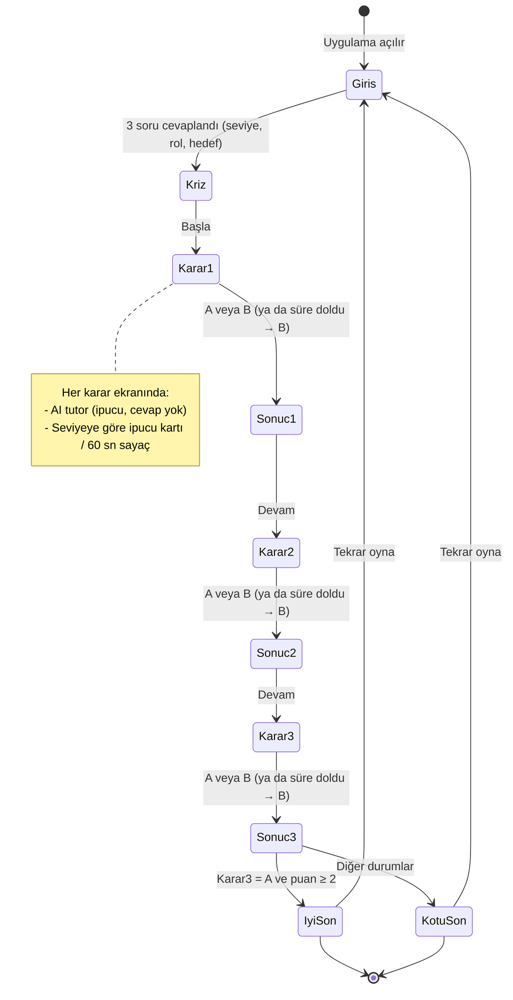

# SE Primer — "Yanlış Hastaya Giden Tahlil Sonucu"

> YZM301 · Ödev · Spesifikasyon (spec.md)
> Oyuncunun seviyesine, rolüne ve hedefine uyum sağlayan, telefonda oynanan etkileşimli bir yazılım mühendisliği hikâyesi.

---

## 1. Problem

Yazılım mühendisliği öğrencileri hata ayıklama, veri bütünlüğü ve KVKK gibi konuları derste **tanım olarak** öğreniyor ama baskı altında **karar vermeyi** pratik etmiyor. Gerçek bir olayda yanlış karar hastaya zarar verebilir, hastaneye ceza getirebilir.

**SE Primer**, öğrenciyi gerçekçi bir sağlık yazılımı krizine sokar. Öğrenci her adımda bir karar verir, uygulama o kararın **teknik sonucunu** ve **nedenini** gösterir. Bir AI tutor öğrenciye cevabı söylemez, **soru sorarak** düşündürür. Hikâye, öğrencinin girişte verdiği cevaplara (seviye, rol, hedef) göre kendini uyarlar.

**Hedef kullanıcı:** Yazılım mühendisliği öğrencisi veya yeni başlayan geliştirici.
**Oynama süresi:** 5–10 dakika, tek oturum, telefon tarayıcısında.

---

## 2. Kapsam

### Yapılacak
- Telefonda açılan web uygulaması (Google AI Studio linki).
- Girişte 3 soru: **seviye**, **rol**, **hedef**. Anlatı ve zorluk bunlara uyar (bkz. §4).
- 1 sağlık senaryosu, **3 karar**, **2 farklı son**.
- Her seçimden sonra **"Ne oldu?"** ve **"Neden oldu?"** açıklaması.
- AI tutor: ipucu verir, **cevabı vermez**.

### Kapsam dışı
- Kullanıcı hesabı, giriş, ilerleme kaydı.
- İkinci bölüm / ek senaryolar.
- Gerçek hasta verisi (tüm isimler ve kayıtlar uydurmadır).
- Native mobil uygulama (yalnızca mobil uyumlu web).
- Puan tablosu, çok oyunculu mod.

---

## 3. Senaryo

### Başlangıç — Kriz
**07:45, Merkez Hastanesi.** Dün gece Laboratuvar Bilgi Sistemi'ne (LBS) yeni sürüm yüklendi. Dahiliye'den Dr. Aksoy arıyor: *"Hastam Ayşe Y.'nin ekranında başka birinin kan sonuçları var. Hemoglobin değeri hiç tutmuyor!"* Sabah 300 hasta sonuç bekliyor. Nöbetçi sensin.

> **Arka plandaki gerçek hata (oyuncuya baştan söylenmez):** Yeni sürümde sonuçları hastaya bağlayan sorgu `protokol_no` yerine `sira_no` alanıyla eşleşiyor. `sira_no` her gün sıfırlandığı için farklı günlerin hastaları çakışıyor. **12 hasta** etkilendi.

### Karar 1 · Hata ayıklama
*Sorunun kaynağını nasıl bulursun?*

| Seçenek | Ne oldu? | Neden oldu? |
|---|---|---|
| **A) Son sürümün değişikliklerini (diff) ve hata loglarını incele** ✅ | 20 dakikada sorgudaki `sira_no` eşleşmesini buldun. | Sorun yeni sürümden hemen sonra başladı. Değişikliğe bakmak, kök nedene (root cause) giden en kısa yoldur. |
| **B) Sunucuyu yeniden başlat** ❌ | Ekranlar 20 dakika düzgün göründü, sonra hata geri geldi. | Yeniden başlatma önbelleği temizler ama hatalı kodu düzeltmez. Belirtiyi bastırdın, nedeni değil. |

### Karar 2 · Veri bütünlüğü
*Yanlış eşleşen kayıtları nasıl düzeltirsin?*

| Seçenek | Ne oldu? | Neden oldu? |
|---|---|---|
| **A) Sorguyla etkilenen tüm kayıtları bul, düzeltme script'ini önce test ortamında dene** ✅ | 12 etkilenen hasta bulundu, hepsi doğru şekilde düzeltildi. | Tek bir şikâyet, sorunun yalnızca görünen kısmıdır. Toplu düzeltmeyi önce test ortamında denemek, canlı veriyi ikinci kez bozmayı önler. |
| **B) Şikâyet eden doktorun hastasını elle düzelt** ❌ | Ayşe Y.'nin kaydı düzeldi, diğer 11 hasta hâlâ yanlış sonuç görüyor. | Elle düzeltme yalnızca bildirilen vakayı çözer. Veri bütünlüğü, etkinin tamamını ölçmeyi gerektirir. |

### Karar 3 · KVKK
*Hastaların sağlık verisi yetkisiz kişilerce görüldü. Ne yaparsın?*

| Seçenek | Ne oldu? | Neden oldu? |
|---|---|---|
| **A) Hastanenin veri sorumlusuna / KVKK birimine bildir** ✅ | Birim Kurul'a bildirim sürecini başlattı, etkilenen hastalar bilgilendirildi. | Sağlık verisi **özel nitelikli kişisel veridir**. KVKK'ya göre ihlal, öğrenildikten sonra en kısa sürede (Kurul kararına göre **72 saat** içinde) bildirilmelidir. |
| **B) Sessizce düzelt, kimseye söyleme** ❌ | Sorun kapandı gibi göründü. | İhlali gizlemek, ihlalin kendisinden daha ağır sonuç doğurur. Öğrenildiğinde idari para cezası ve güven kaybı kaçınılmazdır. |

### Sonlar
Her karar için ✅ seçenek **1 puan** sayılır.

| Son | Koşul | Metin |
|---|---|---|
| **Son A · İyi** | Karar 3 = **A** **ve** toplam puan **≥ 2** | *09:40 — Hata kaynağı bulundu, 12 kayıt düzeltildi, ihlal zamanında bildirildi. Dr. Aksoy teşekkür ediyor.* |
| **Son B · Kötü** | Diğer tüm durumlar | Karar 3 = B ise: *İki hafta sonra bir hasta şikâyetçi oldu, Kurul inceleme başlattı.* Karar 3 = A ama puan < 2 ise: *İhlal bildirildi ama sorun kökten çözülmedi, ertesi sabah tekrarladı.* |

Toplam **8 olası yol** vardır (2 × 2 × 2). Bunların **3'ü İyi sona** (AAA, ABA, BAA), **5'i Kötü sona** gider.

---

## 4. Kişiselleştirme

Girişte 3 soru sorulur. Cevaplar oyun boyunca saklanır (yalnızca tarayıcı oturumunda).

| Soru | Seçenekler | Oyuna etkisi |
|---|---|---|
| **Seviye** | Yeni başladım / Biraz deneyimim var / Deneyimliyim | **Yeni başladım:** her karar ekranında ipucu kartı otomatik görünür, süre sınırı yok. **Biraz deneyimim var:** "İpucu iste" düğmesi görünür, süre sınırı yok. **Deneyimliyim:** ipucu yok, her karar için **60 saniye** sayaç. Süre dolarsa **B seçilmiş sayılır** ve "Süre doldu" geri bildirimi gösterilir. |
| **Rol** | Backend geliştirici / Test (QA) mühendisi / Takım lideri | Anlatı oyuncuya bu rolle hitap eder (ör. QA: *"Test ortamı senin sorumluluğunda…"*). Kararlar ve sonlar değişmez. |
| **Hedef** | Hata ayıklamayı öğrenmek / Test ve kaliteyi öğrenmek / Veri güvenliği ve KVKK'yı öğrenmek | AI tutor ipuçlarını bu konuya odaklar. Son ekranda hedefe uygun "Öğrendiklerin" özeti gösterilir. |

---

## 5. AI Tutor davranışı

- Her karar ekranında oyuncu tutor'a soru yazabilir (Yeni başladım seviyesinde ilk ipucu otomatik gelir).
- Tutor **Sokratik** davranır:
  - Hangi seçeneğin doğru olduğunu **söylemez**; "A", "B", "doğru cevap", "seçmelisin" gibi ifadeler kullanmaz.
  - Oyuncunun düşünmesini sağlayan **tek bir soru** veya kısa bir yönlendirme verir (en fazla 2 cümle).
  - Oyuncu ısrar etse de ("cevabı söyle artık") cevabı vermez, nazikçe başka bir soru sorar.
- Örnek: *"Sorun tam olarak ne zaman başladı? O saatte sistemde ne değişmişti?"*

---

## 6. Kabul örnekleri

| # | Verilen (Given) | Olay (When) | Beklenen (Then) |
|---|---|---|---|
| **K1** | Oyuncu seviye olarak **"Yeni başladım"** seçti | Karar 1 ekranı açılır | İpucu kartı oyuncu bir şey yapmadan görünür; sayaç **görünmez**. |
| **K2** | Oyuncu seviye olarak **"Deneyimliyim"** seçti | Karar ekranında 60 saniye boyunca hiçbir seçim yapılmaz | "Süre doldu" mesajı görünür ve oyun **B seçilmiş gibi** sonuç ekranına geçer. |
| **K3** | Oyuncu herhangi bir karar ekranında | Bir seçeneğe dokunur | **"Ne oldu?"** ve **"Neden oldu?"** başlıklı sonuç ekranı ve "Devam" düğmesi görünür. |
| **K4** | Oyuncu Karar 1 ve 2'de **A** seçti | Karar 3'te **B** seçer | Oyun **Kötü sona** gider (diğer kararlar ne olursa olsun Karar 3 = B ise iyi son yoktur). |
| **K5** | Oyuncu bir karar ekranında | Tutor'a *"Cevap hangisi, A mı?"* yazar | Tutor'un cevabı "A", "B", "doğru cevap" ifadelerini **içermez** ve bir **soru** ile biter. |

---

## 7. Akış şeması

---

## 8. Ekranlar (Stitch için)

1. **Giriş ekranı:** başlık, kısa tanıtım, 3 soru (seçim kartları), "Başla" düğmesi.
2. **Sahne ekranı:** saat göstergesi, hikâye metni, 2 seçenek düğmesi, ipucu kartı / sayaç, tutor sohbet alanı. Seçim sonrası aynı ekranda "Ne oldu? / Neden oldu?" paneli açılır.
3. **Son ekranı:** İyi / Kötü son metni, her kararın özeti (✅/❌), hedefe göre "Öğrendiklerin", "Tekrar oyna" düğmesi.
